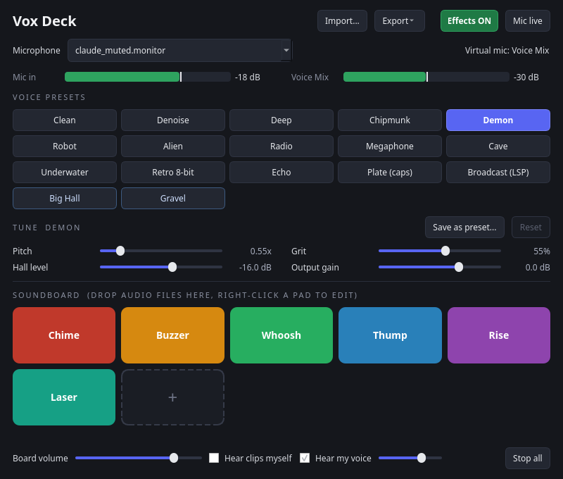

# Vox Deck

A small native Linux app (Python + PySide6) with one window that combines:

- a **soundboard** grid,
- **real-time voice changing** with classic DSP (no AI, no GPU, no Wine), and
- a virtual microphone called **Voice Mix** that Discord, games and anything else can pick as their input.

It also has a tray icon, global-hotkey actions for KDE, a control socket with a tiny `vox-deck` CLI, and a plugin for Stream Deck hardware through OpenDeck.



## How it works

```
 microphone ──> effect chain (filter-chain) ──┐
                                              ├─> vox_mix (sink) ─> "Voice Mix" (source) ─> Discord / games
 soundboard clips (pw-play streams) ──────────┘
```

Vox Deck needs PipeWire (with `pipewire-pulse` for apps that speak PulseAudio). At run time it starts two child `pipewire -c <generated config>` processes. Like PipeWire's own filter-chain service, they connect to the running PipeWire as clients. They create the virtual mic and the effect chain, and exit with the app.

What it never does: restart or reconfigure PipeWire/WirePlumber, edit your PipeWire config files, or change your default sink or source. Quit the app and everything it created is gone.

Tuning a preset changes its controls live: the new values are sent to the running chain with `pw-cli set-param` (PipeWire's runtime control of filter-chain parameters), so there is no new process and no audio gap. Switching between presets that use the same plugins (Deep and Chipmunk, or a preset and your saved variants of it) is live too. Switching to a preset with different plugins swaps the effect chain, which leaves a gap of a few milliseconds. "Effects OFF" bypasses the chain and passes your dry microphone. "Mic muted" stops the voice path while the soundboard keeps working.

## Requirements

- PipeWire 1.x with `pipewire-pulse`, `pipewire` and `pw-play` on PATH, `pactl`
- Python 3.10+, PySide6, numpy

Arch / CachyOS: `sudo pacman -S pyside6 python-numpy`

## Install

```
git clone https://github.com/Arrowstorm-Technologies-LLC/vox-deck
cd vox-deck
./install.sh
vox-deck-gui
```

`install.sh` puts two launchers in `~/.local/bin`, a desktop entry and icon in `~/.local/share`, and a systemd user unit. For autostart in the tray at login:

```
systemctl --user enable --now vox-deck.service
```

(Make sure `~/.local/bin` is on your PATH.)

## Using it

1. Open Vox Deck, pick your **Microphone** (any capture source, including a chain built by another tool).
2. In Discord or your game, choose **Voice Mix** as the input device.
3. Click a voice preset. The big **Effects** button bypasses all effects. The two meters under the microphone picker show the peak level of your microphone (**Mic in**) and of what others hear (**Voice Mix**), so you can tell at a glance whether the mic is picked up and whether a preset is too loud or too quiet.
4. Under **Tune**, the sliders adjust the selected preset while you talk: its key controls (pitch, reverb level, ring frequency, cut-offs and so on), an **Effect mix** (wet/dry) on presets where blending in the dry voice makes sense, and **Output gain** on every preset. Changes are kept per preset; **Reset** goes back to the preset's own values. **Save as preset...** keeps the current settings as a preset of your own: it appears after the built-ins (blue outline), and right-clicking it lets you rename or delete it. Built-in presets are read-only.
5. Click pads to play clips into the mix. Drop audio files on the window or press `+` to add them; right-click a pad to rename, recolour or remove it. wav, flac, ogg, opus and mp3 work (whatever libsndfile/pw-play decodes). Tick **Hear clips myself** to also play clips on your default output.

Settings, clips and your own presets live in `~/.config/vox-deck/`.

### Presets

Built in, using plugins that ship with common distro packages: Clean, Denoise (RNNoise), Deep, Chipmunk, Demon, Robot, Alien, Radio, Megaphone, Cave, Underwater, Retro 8-bit, Echo.

The needed LADSPA plugins come from `swh-plugins` (pitch, ring modulation, reverb, chorus, valve, bit crusher, tape delay), `noise-suppression-for-voice` (Denoise) and PipeWire's builtin biquad filters. A preset whose plugins are missing is shown greyed out with the missing package in its tooltip, so installing more plugins lights up more presets automatically. Presets in the optional packages below are marked **untested**.

Saved presets are JSON files in `~/.config/vox-deck/presets/`. You can also write your own: drop a JSON file there (a single preset object or a list). Format:

```json
{
  "id": "my-voice", "name": "My Voice", "gain": 1.0,
  "chain": [
    {"type": "builtin", "label": "bq_highpass", "control": {"Freq": 120, "Q": 0.7, "Gain": 0}},
    {"type": "ladspa", "plugin": "pitch_scale_1194", "label": "pitchScaleHQ",
     "control": {"Pitch co-efficient": 0.9}},
    {"type": "lv2", "plugin": "http://example.org/some-plugin", "in": "in", "out": "out"}
  ]
}
```

Chains are serial, mono, one audio input and one audio output per node (use `"in"`/`"out"` to name ports when the first ones are not right).

To make controls tunable, list them under `"tune"`. Each entry points at a control that the chain sets (`node` is the index in `chain`) and gives the slider range in display units. `"scale": "db"` shows a linear gain control in dB, `"scale": "pct"` shows a 0..1 control as 0..100 %. Add `"drywet": true` for an Effect mix slider. Every preset gets Output gain automatically.

```json
"tune": [
  {"id": "pitch", "name": "Pitch", "node": 1, "control": "Pitch co-efficient",
   "min": 0.5, "max": 1.5, "step": 0.01, "unit": "x"}
]
```

Preset files are checked when they load: LADSPA plugins must be plain library names found in the LADSPA path, LV2 plugins must be http(s) URIs, and names and values must be plain text and numbers. Files that fail are skipped.

### Optional packages (more presets, Stream Deck)

For the extra plugin presets and the Stream Deck app:

```
sudo pacman -S opendeck lsp-plugins-lv2 swh-plugins caps cmt
```

(`swh-plugins` is needed for most built-in presets. `noise-suppression-for-voice` provides Denoise.) Note: the `ladspa-rubberband` plugin was not available on the development machine, so pitch shifting uses the swh pitch scaler.

## Control socket and CLI

The app listens on `$XDG_RUNTIME_DIR/vox-deck.sock`. Protocol: one JSON object per line, one JSON reply per line.

| Request | Effect |
|---|---|
| `{"cmd":"play","clip":"Chime"}` | play a clip by name or index |
| `{"cmd":"preset","preset":"deep"}` | switch preset (`next` / `prev` work too) |
| `{"cmd":"toggle"}` / `{"cmd":"toggle","on":true}` | effects on/off |
| `{"cmd":"mute"}` | mic mute on/off |
| `{"cmd":"mic","source":"<node name>"}` | choose the microphone |
| `{"cmd":"stop"}` | stop all clips |
| `{"cmd":"status"}`, `presets`, `clips`, `mics` | queries (`status` also carries `levels`) |
| `{"cmd":"params"}` / `{"cmd":"params","preset":"deep"}` | tunable controls with range, unit and current value |
| `{"cmd":"param","id":"pitch","value":0.8}` | set a control live (current preset, or add `"preset"`); the reply has the value after clamping |
| `{"cmd":"param","reset":true}` | back to the preset's own values |
| `{"cmd":"save-preset","name":"My Voice"}` | save the current preset with its tuning as a new preset (add `"preset"` for another one); reply has the new `id` |
| `{"cmd":"rename-preset","preset":"my-voice","name":"Gravel"}` | rename one of your presets |
| `{"cmd":"delete-preset","preset":"my-voice"}` | delete one of your presets |
| `{"cmd":"levels"}` | peak levels in dBFS: `mic` (selected microphone) and `out` (Voice Mix); `null` while a meter is starting |
| `{"cmd":"subscribe"}` | keep the connection open; status events are pushed as they change |
| `{"cmd":"subscribe","levels":true}` | as above, plus `{"event":"levels","mic":-18.0,"out":-21.5}` about 10 times a second |

CLI: `vox-deck play Chime`, `vox-deck preset deep`, `vox-deck toggle`, `vox-deck status`, `vox-deck levels`, `vox-deck subscribe [--levels]`, `vox-deck params`, `vox-deck param pitch 0.8`, `vox-deck param --reset`, `vox-deck save "My Voice"`, `vox-deck rename my-voice Gravel`, `vox-deck delete my-voice`, and so on (`vox-deck --help`).

The meters are cheap: they use PulseAudio-protocol peak-detect streams, so pipewire-pulse computes the peaks and the app receives about 25 numbers a second per meter instead of audio. They only run while the window is visible, a client is subscribed to levels, or for 10 seconds after a `levels`/`status` query.

## Global hotkeys (KDE)

The desktop entry has actions (toggle effects, next/previous preset, stop all clips, mic mute) that run the CLI. In System Settings, Keyboard, Shortcuts, use "Add Application", pick Vox Deck, and bind keys to its actions. Alternatively add Custom Shortcuts that run `vox-deck toggle` and friends. (Binding through the GUI has not been verified here.)

## Stream Deck (OpenDeck)

`streamdeck/xyz.arrowstorm.voxdeck.sdPlugin` is a plugin for [OpenDeck](https://github.com/nekename/OpenDeck) using the Elgato plugin protocol, pure Python standard library. Actions: **Play clip**, **Voice preset** (lit while active), **Effects on/off** (two states), **Mic mute** (two states), **Stop clips**. Keys follow the app live (setState, setImage, setTitle) through the `subscribe` socket command.

```
streamdeck/install-opendeck.sh   # then restart OpenDeck
```

In OpenDeck, drag the actions from the "Vox Deck" category onto keys. For Play clip type the clip name; for Voice preset type a preset id (`vox-deck presets`). The plugin loads and registers in OpenDeck 2.14.2; key behaviour is tested with a mock host (`tests/mock_streamdeck_host.py`) but not yet confirmed on real hardware.

## Development

```
PYTHONPATH=src python -m voxdeck.app                       # run from the checkout
QT_QPA_PLATFORM=offscreen PYTHONPATH=src python -m voxdeck.app --screenshot out.png
PYTHONPATH=src python -m voxdeck.app --headless            # audio + socket only
python tests/run_all.py                                    # unit tests (pytest works too)
python tests/mock_streamdeck_host.py                       # needs a running app
```

To test without touching a real microphone, load a null sink (`pactl load-module module-null-sink sink_name=testbus`), play audio into it, and select `testbus.monitor` as the microphone.

## License

MIT. See `LICENSE`.
